# Plant Leaf Disease Detection

**CNN and transfer learning with Grad-CAM explainability, autoencoder compression and denoising, and FGSM adversarial robustness, deployed as a Streamlit app.**


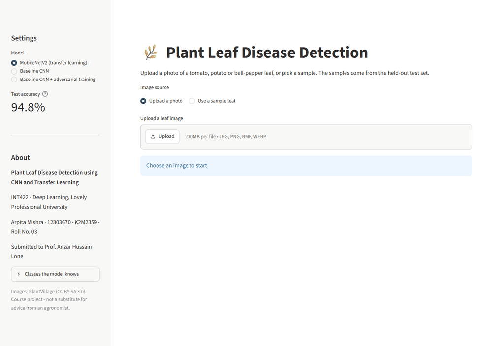

## Overview

Course project for **INT422 - Deep Learning**, Lovely Professional University. The system recognises ten conditions of
tomato, potato and bell-pepper leaves, shows *why* it made a decision, and measures how easily it can be fooled.
Everything was trained on a dual-core CPU.

## Problem

Crop diseases show early signs on leaves, but experts are scarce. Can a photograph give a useful first opinion, can we see
what the model looks at, and how far can its accuracy be trusted?

## Features

- **Two classifiers:** a CNN built from scratch (111,514 parameters) and a fine-tuned MobileNetV2
- **Leakage-free evaluation:** images of one physical leaf never cross splits
- **Explainability:** activation maps and Grad-CAM
- **Autoencoders:** 12:1 compression, denoising, and a small VAE
- **Adversarial robustness:** FGSM from scratch with `tf.GradientTape`, plus adversarial training
- **Background-bias probe:** how much can eight border pixels reveal?
- **Streamlit demo** with upload, samples, Grad-CAM, FGSM slider and autoencoder views

## Results

Test set: 420 images of unseen leaves.

| Model | Accuracy | 95% interval | Macro F1 | Parameters | File |
|---|---|---|---|---|---|
| Baseline CNN | **91.43%** | 88.4 to 93.7% | 0.919 | 111,514 | 1.4 MB |
| MobileNetV2 transfer | **94.76%** | 92.2 to 96.5% | 0.946 | 2,270,794 | 23.1 MB |

| FGSM epsilon | Baseline | Transfer | Baseline + adversarial training |
|---|---|---|---|
| 0 | 91.4% | 94.8% | 86.7% |
| 0.0025 | 57.4% | 27.9% | 75.7% |
| 0.005 | 37.4% | 10.5% | 65.7% |
| 0.01 | 14.0% | 2.6% | 46.0% |
| 0.02 | 4.0% | 2.4% | 27.9% |
| 0.04 | 2.6% | 2.1% | 13.6% |
| 0.08 | 8.1% | 7.1% | 9.8% |

| Autoencoder task (64x64 test images) | PSNR | SSIM | Reference |
|---|---|---|---|
| Compression to 1,024 bytes (12:1) | 24.06 dB | 0.671 | JPEG, same size: 27.63 dB |
| Denoising (sigma 0.1) | 27.13 dB | 0.769 | noisy 20.15 dB, Gaussian filter 25.99 dB |

> **Read these numbers with care.** A random forest that sees only 8 border pixels reaches 52.1%
> (majority class 10.7%), so PlantVillage backgrounds leak label information. Laboratory accuracy is not field accuracy.

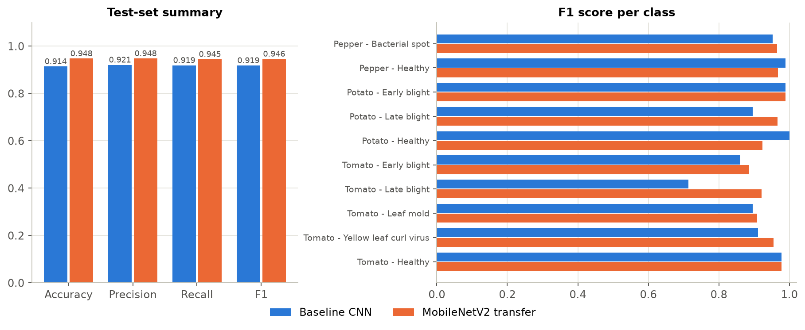

| Grad-CAM | FGSM robustness |
|---|---|
| 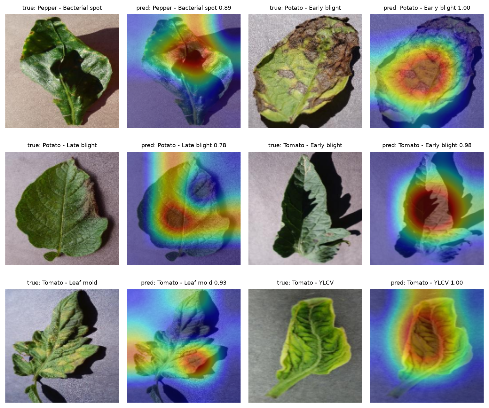 | 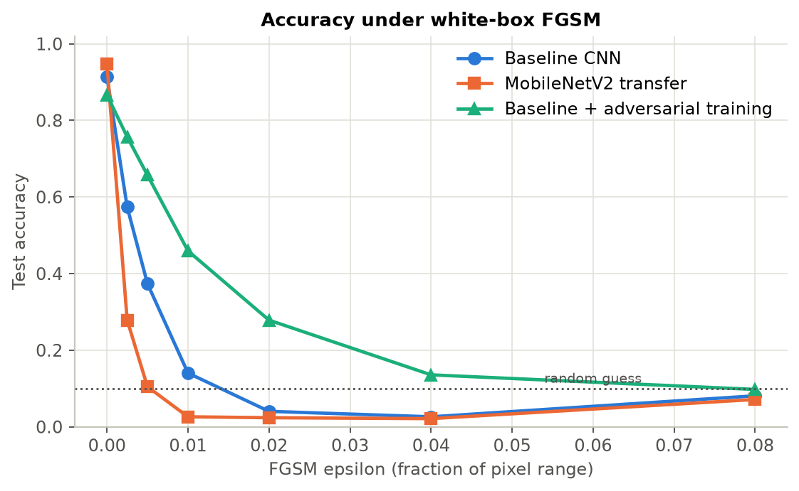 |

## Screenshots

| Prediction | Grad-CAM |
|---|---|
| 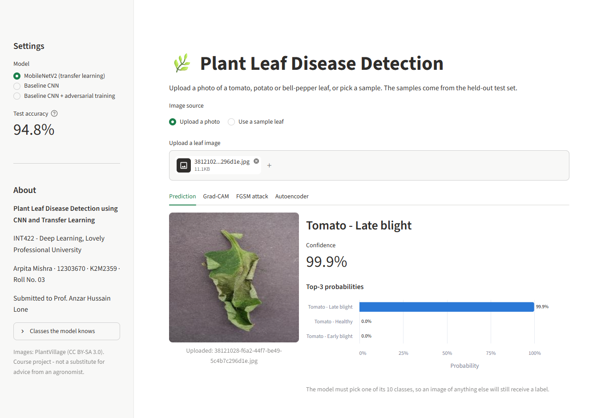 | 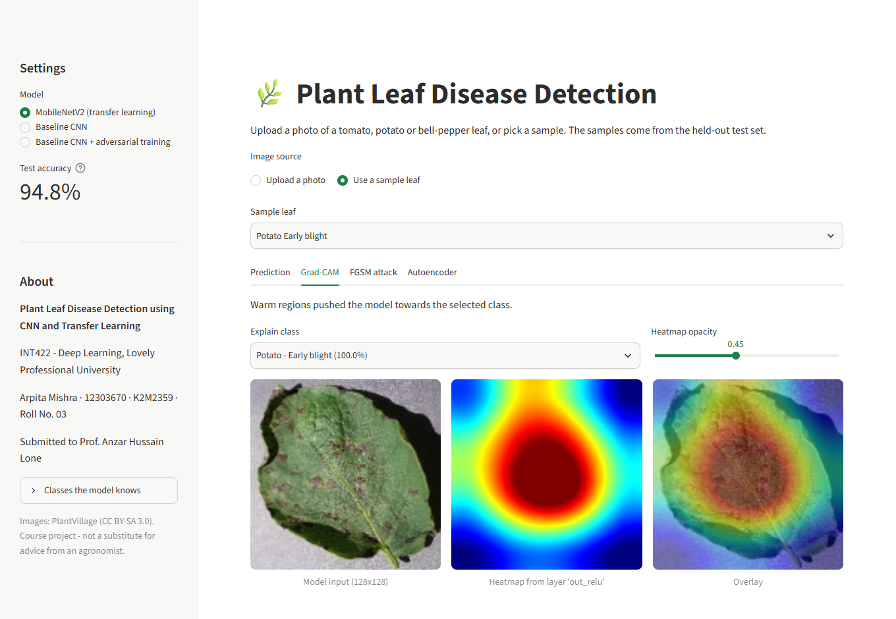 |
| **FGSM attack** | **Autoencoder** |
| 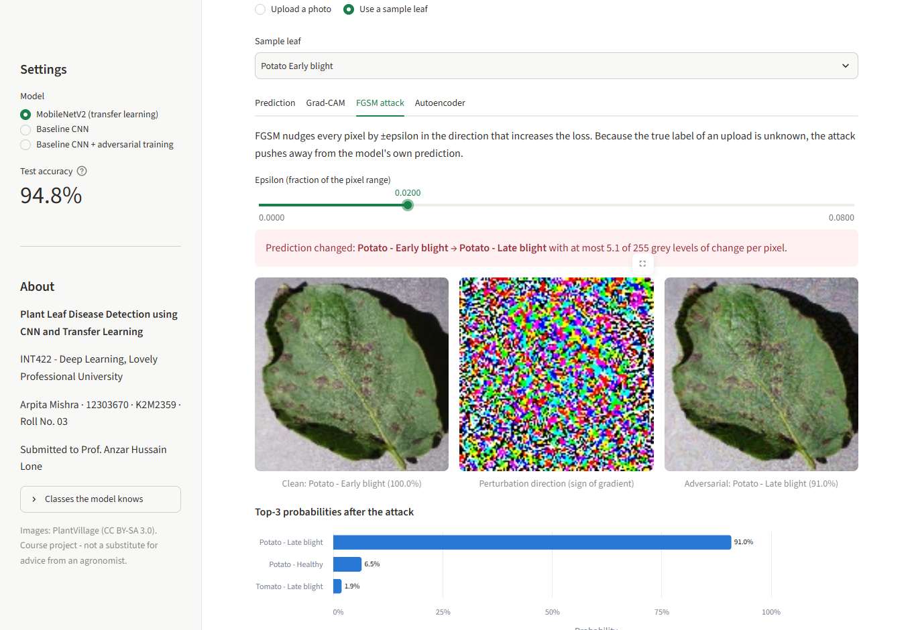 | 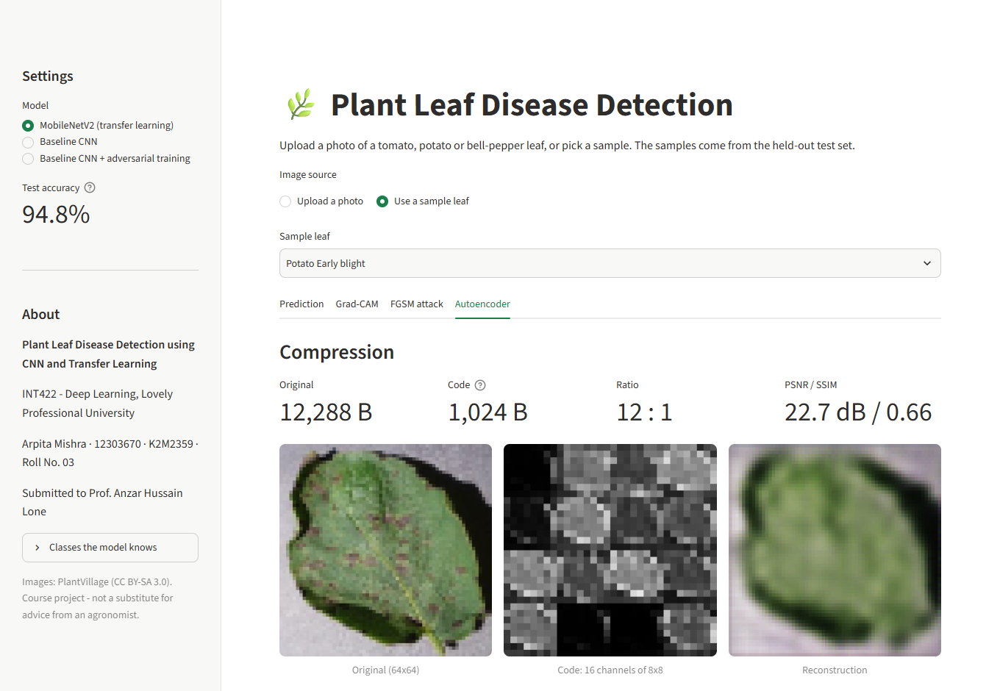 |

## Dataset

[PlantVillage](https://huggingface.co/datasets/mohanty/PlantVillage) (CC BY-SA 3.0): 2,852 images, 10 classes, at most
300 per class, split 2,011 / 421 / 420 by leaf.
`data/manifest.csv` records every file, leaf, split and checksum. Images are not stored in git; `src.prepare_data` downloads
about 45 MB with HTTP range requests and verifies them.

## Architecture

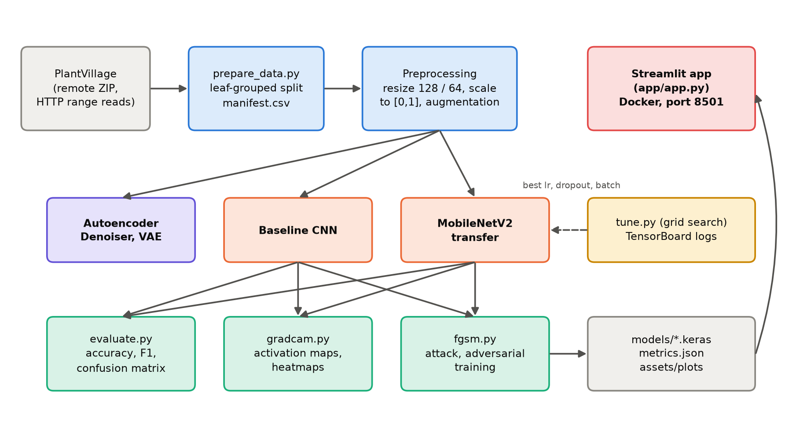
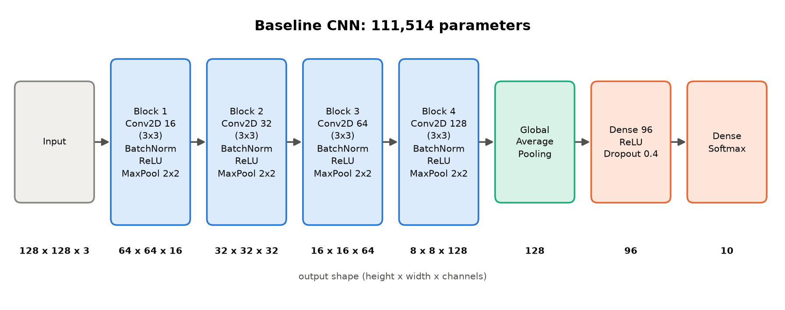
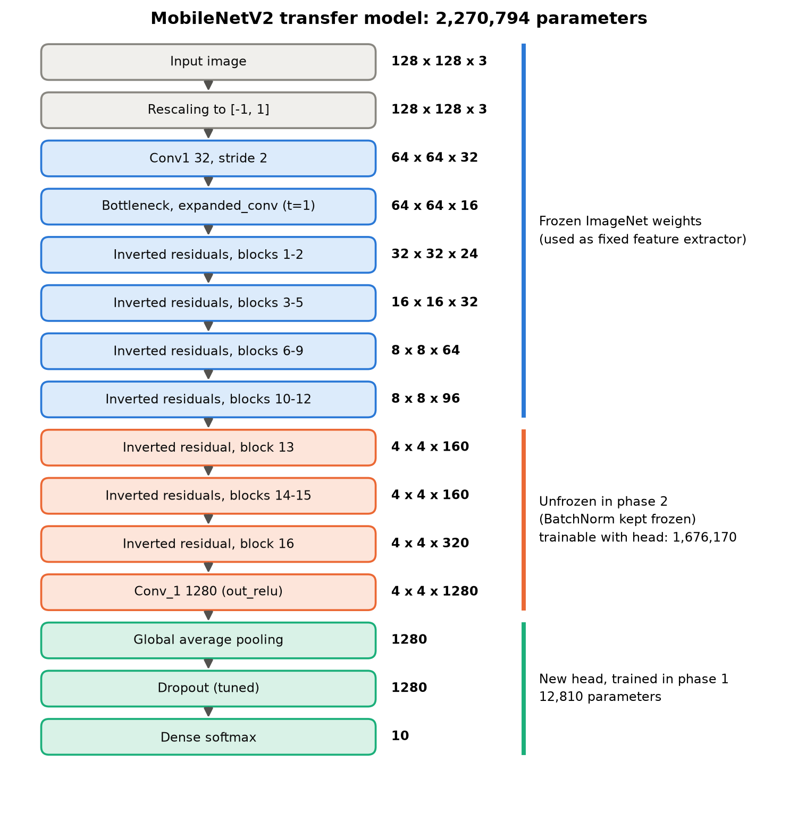
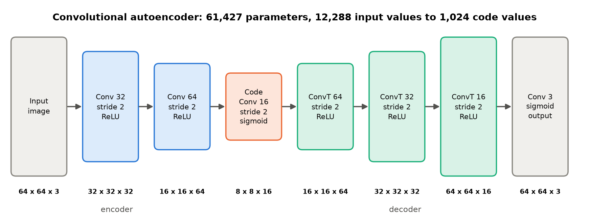

## Installation

Python 3.12 is required.

```bash
git clone https://github.com/Arpita-2755/plant-disease-detection-dl.git
cd plant-disease-detection-dl
python -m venv .venv
.venv\Scripts\activate          # Linux / macOS: source .venv/bin/activate
pip install -r requirements.txt
```

Notes for Windows: keep the folder path short (TensorFlow has long file names) or enable long paths. If Smart App Control is
on, the first imports may report that a file was blocked while Windows checks it; run the command again.

## Usage

Run the demo (trained models are included):

```bash
streamlit run app/app.py
```

Reproduce everything (under an hour of training on a dual-core CPU):

```bash
python -m src.prepare_data      # download and verify the subset
python -m src.run_all           # EDA, training, evaluation, attacks
tensorboard --logdir logs       # training curves and graphs
```

Single steps: `python -m src.eda`, `src.train_baseline`, `src.tune`, `src.train_transfer`, `src.evaluate`, `src.gradcam`,
`src.autoencoder`, `src.fgsm`, `src.bias_probe`,
`src.tb_graph`, `src.diagrams`. Set `PLANT_FAST=1` and `PLANT_OUTPUT_ROOT=some/folder` for a
quick smoke test that does not touch the real results.

The notebook [`notebooks/plant_disease_workflow.ipynb`](notebooks/plant_disease_workflow.ipynb) reproduces the workflow with outputs
(`pip install -r requirements-dev.txt`).

### Docker

```bash
docker build -t plant-disease .
docker run -p 8501:8501 plant-disease
```

Docker was not available on the development machine, so the image has **not** been built or tested yet. The same start command
was tested outside a container. TensorFlow's Linux wheels need a processor with AVX.

## Project structure

```
app/            Streamlit app and sample leaves (from the test split)
assets/         diagrams, plots, screenshots
data/           manifest.csv (images are downloaded)
logs/           TensorBoard logs (generated)
models/         trained .keras models
notebooks/      executed workflow notebook
report/         project report (.docx, .pdf)
src/            data, models, training, evaluation, attacks
tests/          headless test of the demo app (python tests/test_app.py)
tools/          screenshots, notebook, docs and report builders
metrics.json    every measured number
```

## Tech stack

TensorFlow / Keras, NumPy, pandas, scikit-learn, scikit-image, OpenCV, Matplotlib, seaborn, Streamlit, Altair, TensorBoard,
Docker, Playwright, python-docx.

## Syllabus mapping (INT422)

| Topic | Where |
|---|---|
| Unit I: tensors, optimizers, TensorBoard | `src/eda.py`, `src/tune.py`, `logs/` |
| Unit II: Keras, over/underfitting, tuning, save/load | `src/models.py`, `src/train_baseline.py`, `src/tune.py` |
| Unit III: CNN, transfer learning, augmentation | `src/models.py`, `src/train_transfer.py`, `src/common.py` |
| Unit IV: autoencoders, denoising, VAE | `src/autoencoder.py` |
| Unit VI: FGSM, Docker, Streamlit | `src/fgsm.py`, `Dockerfile`, `app/app.py` |
| Practicals: activation maps, evaluation, pretrained models | `src/gradcam.py`, `src/evaluate.py`, notebook |
| CO2: NVIDIA DGX Station A100, CUDA | Report, Chapter 7 |

## Future work

Field photographs and leaf segmentation, all 38 classes on a GPU, PGD adversarial training, confidence calibration with an
abstain option, and TensorFlow Lite for phones.

## Author

**Arpita Mishra** - Reg. No. 12303670, Roll No. 03, Section K2M2359
School of Computer Science and Engineering, Lovely Professional University
Submitted to Professor Anzar Hussain Lone

## License

Code: [MIT](LICENSE). Leaf images: PlantVillage, CC BY-SA 3.0 (Hughes and Salathé, 2015; Mohanty et al., 2016).
